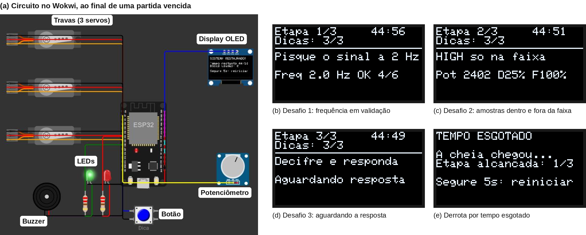

# Escape Box com ESP32

Escape Box educacional para o ensino introdutório de sistemas embarcados. Equipes de estudantes programam uma placa ESP32, e um segundo ESP32, trancado dentro da caixa, verifica pelo comportamento elétrico da placa se o código cumpre a regra de cada desafio. Cada desafio vencido abre uma trava.

Projeto do Trabalho de Conclusão de Curso de Vinicius Alves da Costa (Engenharia de Software, FUCAPI, 2026), orientado pelo Prof. Mário Sérgio Cavalcante e conduzido pela Design Science Research.

- **Simulação no Wokwi:** https://wokwi.com/projects/480636863090165761
- **Desafios:** (1) saída digital: piscar um pino a 2 Hz; (2) entrada analógica: sinal HIGH só com o potenciômetro dentro de uma faixa; (3) comunicação serial: decifrar mensagens com cifra de César pela UART.

| Figura | Arquivo |
|---|---|
| Arquitetura do artefato | `docs/figuras/arquitetura.png` |
| Máquina de estados do firmware | `docs/figuras/maquina_de_estados.png` |
| Simulação no Wokwi | `docs/figuras/simulacao_wokwi.png` |

## Arquivos

| Pasta | Onde gravar | Para que serve |
|---|---|---|
| `mestre/` | ESP32 dentro da caixa | Controla travas, tempo, tela e valida os desafios |
| `aluno_modelo/` | Placa do aluno | Modelo que o aluno recebe; no desafio 3, a UART já vem pronta e falta só a função `decifrar()` |
| `gabarito/` | Placa do aluno | Soluções dos 3 desafios, para testar a caixa |
| `docs/roteiro_aplicacao.md` | (leitura) | Roteiro para o professor: preparação, conversa inicial, partida, conversa final e reinício |

Bibliotecas do mestre: **ESP32Servo**, **Adafruit SSD1306** e **Adafruit GFX**. O LittleFS já vem no core do ESP32.

## Mapa de pinos: mestre

| Componente | GPIO |
|---|---|
| Servo comp. 1 / comp. 2 / tampa | 13 / 14 / 27 |
| OLED SDA / SCL | 21 / 22 |
| Buzzer | 25 |
| LED verde / vermelho (com 220Ω) | 26 / 33 |
| Botão de dica (para GND) | 32 |
| Sinal vindo do aluno | 18 |
| Wiper do potenciômetro | 36 (VP) |
| UART RX / TX | 16 / 17 |

## Ligações entre as placas

| Mestre | | Aluno |
|---|---|---|
| GND | direto | GND |
| GPIO 18 | resistor 1k | GPIO 23 |
| GPIO 16 (RX) | resistor 1k | GPIO 17 (TX) |
| GPIO 17 (TX) | resistor 1k | GPIO 16 (RX) |
| GPIO 36 | wiper do pot. (1k até o aluno) | GPIO 34 |

Potenciômetro: pontas no 3V3 e GND do mestre, wiper nas duas placas.

## Alimentação

- Fonte 5V 2A alimenta os servos (fio vermelho) e o VIN do mestre. Todos os GND juntos.
- Capacitor eletrolítico de **470µF** entre 5V e GND, perto dos servos, para evitar reset quando eles se movem.
- Placa do aluno alimentada pelo USB do notebook.
- OLED no 3V3.
- Buzzer ativo: se for de 5V e soar fraco no GPIO, use um transistor (BC337 ou 2N2222) com resistor de 1k na base.

## Pistas físicas

- **Comp. 1** (abre após D1): cartão com "Ative o sinal só entre 2000 e 2800".
- **Comp. 2** (abre após D2): cartão com "Chave da cifra: volte cada letra 7 posições no alfabeto. A caixa envia MSG:XXXXX. Completem a função decifrar() do modelo."
- **Tampa** (abre após D3): prêmio ou mensagem final.

## Antes de montar na caixa

1. Monte tudo na protoboard.
2. Grave o `mestre` e teste o modo manutenção (segure o botão ao ligar).
3. Ajuste `ANG_TRAVADO` e `ANG_ABERTO` conforme o trinco.
4. Grave o `gabarito` com `DESAFIO 1`, depois 2, depois 3, e jogue uma partida inteira.
5. **Calibração do D2:** as duas placas leem o potenciômetro com pequenas diferenças. Compare o valor na tela do mestre com o Monitor Serial do aluno. Se diferirem mais de 150, aumente `TOLERANCIA`.

## Log da partida

Cada evento vira uma linha `LOG,<segundos>,<evento>,<detalhe>`, impressa no Monitor Serial e gravada na flash do mestre (`/partida.csv`). Ao iniciar uma nova partida, a anterior passa para `/anterior.csv`.

**Atenção:** nas DevKit, abrir o Monitor Serial reinicia o ESP32 (sinais DTR/RTS). Não abra o monitor durante a partida. Depois que ela terminar, abra o monitor e envie:

| Comando | Efeito |
|---|---|
| `L` | Imprime o log da partida atual |
| `A` | Imprime o log da partida anterior |
| `C` | Apaga os dois logs |

Se o reset acontecer, a partida em andamento se perde, mas o log gravado até ali continua na flash.

### Dicionário de eventos

| Evento | Detalhe | Quando ocorre |
|---|---|---|
| `boot` | vazio | O mestre ligou (só no Monitor Serial) |
| `inicio` | vazio | O botão iniciou a partida |
| `erro_d1` | frequência medida, em Hz, ou `sem_oscilacao` (`;continua` quando o erro persiste) | Começou um episódio de frequência fora de 1,8 a 2,2 Hz, ou o sinal parou por mais de 2 s depois de ter oscilado (pino fixo ou programa travado, sem bip); ou o erro continua após 5 s |
| `erro_d2` | `dentro_low` ou `fora_high` | Começou um episódio de sinal incoerente com a faixa |
| `erro_d3` | `atraso` ou `esperado=X;recebido=Y` | Resposta atrasada ou errada |
| `dica` | `etapa-número da dica` | Dica pedida (desconta 3 minutos) |
| `etapa_concluida` | `etapa;duracao_s;episodios_erro` | Etapa liberada |
| `vitoria` | `restante_s;dicas` | Tampa final aberta |
| `derrota` | `etapa;dicas` | Tempo esgotado |

Um **episódio de erro** é registrado uma vez quando o erro começa. O episódio só se encerra quando a equipe acerta de forma sustentada: dois ciclos seguidos dentro da frequência no desafio 1, dez amostras boas seguidas (0,5 s) no desafio 2 ou uma resposta certa no desafio 3. Enquanto o erro persiste, ele é registrado de novo no máximo a cada 5 segundos. Isso evita que o desafio 2, que amostra o sinal a cada 50 ms, gere dezenas de linhas por segundo, inclusive quando o pino alterna sem ler o potenciômetro. A repetição leva `;continua` no fim do detalhe e não conta como episódio novo: o campo `episodios_erro` de `etapa_concluida` conta só os episódios.

Os episódios de erro medem o comportamento da equipe com o artefato. Eles não são, sozinhos, evidência de aprendizagem individual.

## Desafio 3: cifra

A caixa sorteia um código de 5 letras maiúsculas a cada mensagem (26^5, cerca de 11,9 milhões de combinações). Como o código muda a cada envio, montar uma tabela de respostas não funciona: a equipe precisa implementar a decifragem. O prazo de 3 segundos vale para o programa responder, não para a equipe; ela tem o tempo da partida para escrever o código.

## Testes adicionais (bancada ou simulação)

| ID | Caso | Esperado |
|---|---|---|
| TA01 | Placa do aluno com o GPIO 23 configurado como entrada, sem código | Etapa 1 não avança; nada danifica (RNF03) |
| TA02 | Pino de sinal configurado como saída nas duas placas, em níveis opostos | Corrente limitada a cerca de 3 mA pelo resistor de 1 kΩ; nenhuma placa reinicia (RNF03) |
| TA03 | Desafio 2 com o pino alternando rápido, sem ler o potenciômetro | Progresso zera; um episódio `erro_d2` por vez no log |
| TA04 | Desafio 3 respondendo sempre o mesmo texto | Nenhum acerto; `erro_d3` com esperado e recebido |
| TA05 | Abrir o Monitor Serial depois da partida e enviar `L` | Log completo da partida impresso |

## Simulação no Wokwi

A pasta `simulacao_wokwi/` tem o projeto para o simulador Wokwi (ESP32 DevKit V1), publicado em https://wokwi.com/projects/480636863090165761. Como o Wokwi não simula duas placas no mesmo projeto, a lógica do mestre roda no `loop()` e a placa da equipe roda numa tarefa FreeRTOS, ligadas por fios externos como no hardware real (GPIO 23 → 18, GPIO 4 → RX2, TX2 → GPIO 5). No Monitor Serial, os dígitos 0 a 8 escolhem o cenário da equipe e T reduz o tempo restante para 10 s. Os cenários 1, 4 e 6 rodam o código do `gabarito.ino` sem alteração; a única adaptação é que a Serial2 do gabarito passa a ser a Serial1 da tarefa da equipe (pinos 5 e 4), porque os pinos 16 e 17 são do mestre. Os demais cenários simulam soluções erradas de propósito.

Arquivos para criar no Wokwi: `sketch.ino`, `diagram.json`, `libraries.txt` e `partitions.csv`. Sem o `partitions.csv`, a tabela de partições padrão do Wokwi não tem a partição `spiffs` e o LittleFS não monta (o log continua no Monitor Serial). Na primeira execução o LittleFS informa "mount failed (-84)" e formata a partição; é o comportamento esperado.

O potenciômetro do Wokwi vai de 0 a 1023 na interface; o valor 600 corresponde a cerca de 2400 no ADC, dentro da faixa do desafio 2.

O resultado de cada caso de teste está em `simulacao_wokwi/resultados/casos_de_teste.md`, com os logs das partidas na mesma pasta.

## Licença

O código (pastas `mestre/`, `aluno_modelo/`, `gabarito/` e `simulacao_wokwi/`) está sob a licença MIT, no arquivo `LICENSE`. A documentação, o roteiro de aplicação e as figuras (pasta `docs/` e este README) estão sob a licença Creative Commons Atribuição 4.0 Internacional (CC BY 4.0): https://creativecommons.org/licenses/by/4.0/deed.pt_BR. Nos dois casos, o uso, a adaptação e a redistribuição são livres, desde que o crédito ao autor seja mantido.
